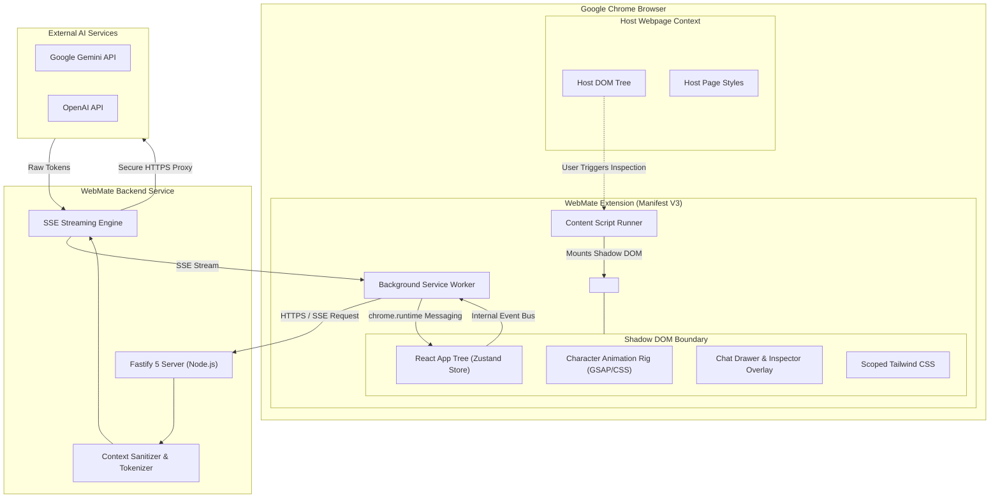
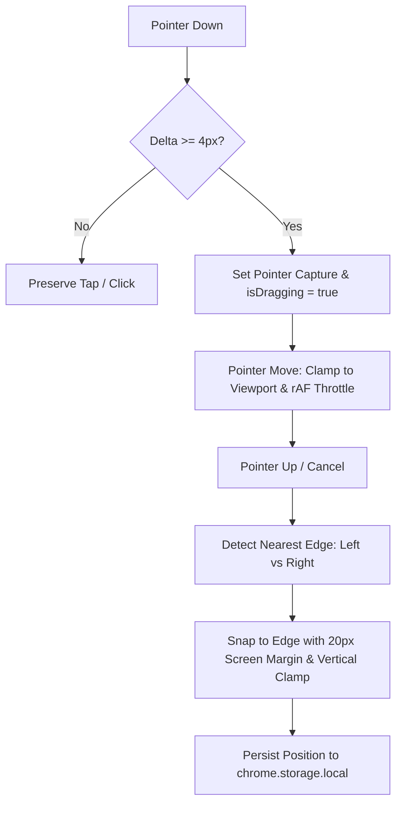
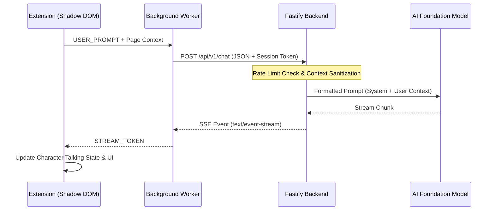

# WebMate — System Architecture

This document describes the architectural design of WebMate, covering the Chrome extension client, the articulated character animation subsystem, backend gateway, Shadow DOM isolation model, inter-process communication (IPC), and security perimeters.

---

## 1. System Architecture Diagram



---

## 2. Chrome Extension Architecture (`@webmate/extension`)

The extension follows the Chrome Manifest V3 execution model, split into three decoupled tiers:

### A. Background Service Worker (`entrypoints/background.ts`)
- **Role**: Event-driven background orchestrator.
- **Responsibilities**:
  - Responds to extension installation, updates, and icon clicks.
  - Acts as a secure HTTP client to communicate with the `@webmate/backend` service.
  - Manages cross-tab state, persistent extension settings in `chrome.storage.local`.
  - Dispatches messages to active content scripts.

### B. Content Script & Shadow DOM Injection (`entrypoints/content/`)
- **Role**: Injected bridge living within the webpage context.
- **Responsibilities**:
  - Validates host webpage URL compatibility (HTTP/HTTPS only; excludes internal schemes).
  - Enforces singleton mounting (guards against duplicate `<webmate-root>` injection).
  - Injects a dedicated custom element (`<webmate-root>`) appended to `document.body`.
  - Attaches an **open Shadow DOM** (`shadowRoot = host.attachShadow({ mode: 'open' })`).
  - Scopes Tailwind CSS and CSS resets inside the Shadow Root.
  - Renders WebMate's React 18 application tree into `#webmate-app-root`.
  - Handles graceful unmounting on extension invalidation or page unload.

### C. Extension Action Popup (`entrypoints/popup/`)
- **Role**: Quick toolbar interface.
- **Responsibilities**:
  - Displays extension status, global on/off toggle, and link to options.
  - Summarizes current session activity and backend connectivity.

---

## 3. Shadow DOM Isolation Strategy

Injecting custom UI into arbitrary third-party websites presents significant styling and DOM conflict risks:
1. Host CSS rules (e.g. `* { box-sizing: border-box; font-family: ... }` or resets) could corrupt companion elements.
2. Companion CSS rules could inadvertently alter host page layout and typography.
3. Host page JavaScript could traverse and manipulate extension DOM nodes.

```
+-------------------------------------------------------+
| Host Webpage Document Body                            |
|                                                       |
|   <div class="header">...</div>                       |
|   <main class="content">...</div>                     |
|                                                       |
|   <webmate-root>                                      |
|     #shadow-root (open)                               |
|       +---------------------------------------------+ |
|       | <style> /* Scoped WebMate Tailwind CSS */ </style> |
|       | <div id="webmate-app-root">                 | |
|       |   <!-- Phase 1 Step 2: Placeholder UI -->   | |
|       |   <div class="webmate-card">...</div>       | |
|       |   <!-- Phase 2+: Planned Character Rig -->  | |
|       | </div>                                      | |
|       +---------------------------------------------+ |
|   </webmate-root>                                     |
+-------------------------------------------------------+
```

### Isolation & Interaction Rules:
- All extension markup lives inside `#shadow-root`.
- Host element `<webmate-root>` uses `:host { all: initial; position: fixed !important; top: 0 !important; left: 0 !important; width: 0 !important; height: 0 !important; overflow: visible !important; z-index: 2147483647 !important; pointer-events: none !important; }` to anchor at the viewport origin without intercepting host clicks or blocking page layouts.
- Inner container `#webmate-app-root` applies `all: initial` and explicit system font resets, keeping `pointer-events: none`.
- Draggable container `#webmate-floating-container` re-enables `pointer-events: auto`, ensuring that ONLY interactions with the companion card are captured.
- Tailwind CSS styles are compiled and injected directly inside the shadow root via WXT's `cssInjectionMode: 'ui'`.
- Events generated inside the Shadow DOM (clicks on companion elements) are isolated from host listeners.

---

## 4. Draggable Floating Companion & Docking System (Implemented in Phase 1, Step 3)

WebMate provides a complete floating companion interaction system:



### Key Technical Mechanisms:
1. **Pointer Interaction**: Uses W3C Pointer Events (`onPointerDown`, `onPointerMove`, `onPointerUp`, `onPointerCancel`) to natively support mouse, touch, and pen styluses.
2. **Pointer Capture**: Explicitly invokes `setPointerCapture(pointerId)` upon crossing the 4px drag threshold, ensuring continuous tracking even if the cursor moves rapidly outside the card boundary.
3. **Ghost Drag & Selection Protection**: Card styles enforce `user-select: none` and `touch-action: none` to prevent accidental text selection or viewport scroll interference during dragging.
4. **GPU-Accelerated Smooth Motion**: Card translation uses `transform: translate3d(x, y, 0)` updated via `requestAnimationFrame` throttling, avoiding layout reflows and guaranteeing 60fps responsiveness.
5. **Horizontal Edge Docking**: When released, WebMate calculates the card midpoint relative to the viewport width and smoothly transitions to the nearest edge (left or right) maintaining a comfortable 20px margin and preserving vertical positioning.
6. **Position Persistence**: State is serialized to `chrome.storage.local` with both absolute coordinates and normalized vertical ratios (`relativeY`), ensuring that resizing or navigating between differently sized windows preserves natural relative vertical placement.
7. **Graceful Degradation**: If Chrome Storage APIs are unavailable, WebMate gracefully defaults to memory state without throwing errors or interrupting page execution.

---

## 5. Character Animation Subsystem (Planned Architecture)

> [!NOTE]
> **Implementation Status**: The articulated character rig, animation controller, dynamic pointing system, and mouth animation driver described below represent the **planned architectural design** scheduled for implementation in Phase 2. No character renderer or animation engine currently exists in the codebase.

In the planned Phase 2 implementation, the character companion will be rendered as an articulated, multi-layer vector rig rather than a static raster image. This architectural design enables independent limb movement, dynamic 360° pointing to arbitrary DOM elements, and text-stream-triggered mouth animation paced to incoming AI text tokens.

```mermaid
flowchart LR
    subgraph StateManagement["Zustand Store"]
        CS[characterState: idle | thinking | talking | pointing | ...]
        CE[characterExpression: normal | happy | confused | ...]
        TP[targetPointer: x, y coordinates]
    end

    subgraph Controller["Animation Controller (Planned)"]
        AC[GSAP Timeline Engine + CSS Keyframes]
        MD[Mouth Animation Driver / Token Stream Consumer]
    end

    subgraph Rig["Shadow DOM CharacterRig (Planned)"]
        L6[Layer 6: FX Overlays]
        L5[Layer 5: Face & Mouth Layers]
        L4[Layer 4: Head & Hair]
        L3[Layer 3: Articulated Pointing Arm]
        L2[Layer 2: Torso & Legs]
        L1[Layer 1: Support Arm]
        L0[Layer 0: Ground Shadow]
    end

    CS --> AC
    CE --> AC
    TP --> AC
    MD -->|Mouth Shape| L5
    AC -->|Rotations & Offsets| L3
    AC -->|Tilt & Nod| L4
    AC -->|Bob & Squash| L2
    AC -->|Scale| L0
    AC -->|Particles| L6
```

### Planned Component Architecture:
- **`CharacterContainer`** *(Planned)*: Will handle viewport positioning, dragging physics, edge snapping, and docking states.
- **`AnimationController`** *(Planned)*: Will subscribe to the extension Zustand store and orchestrate GSAP transitions between states (`idle`, `thinking`, `explaining`, etc.).
- **`CharacterRig`** *(Planned)*: Will assemble the hierarchical SVG groups (`#layer-shadow`, `#layer-body`, `#layer-head`, `#layer-features`) with rotational pivots.
- **`MouthAnimationDriver`** *(Planned)*: Will alternate mouth shapes (`mouth-closed`, `mouth-half`, `mouth-open`) keyed directly to incoming SSE text tokens from `@webmate/backend` to provide visual speaking pacing without re-rendering the full character rig. Note: True phoneme-level lip-sync is outside current scope and would require an audio/speech alignment engine.

---

## 5. Backend Gateway Architecture (`@webmate/backend`)

The backend is a Node.js microservice built with **Fastify**:



### Key Responsibilities:
- **API Key Secrecy**: External AI credentials never leave the backend environment.
- **Prompt Guardrails & Sanitization**: Strips HTML tags, script nodes, and masked credentials before sending prompts to the LLM.
- **Streaming Response Gateway**: Implements Server-Sent Events (SSE) so responses stream token-by-token directly to the extension.
- **Rate Limiting**: Protects downstream LLM endpoints from abuse via IP and session throttling.

---

## 6. Security & Isolation Boundaries

| Boundary | Enforcement Mechanism |
| :--- | :--- |
| **Host DOM vs Extension UI** | Shadow DOM (`attachShadow({ mode: 'open' })`) + CSS scoping |
| **Extension vs Network** | Strict Manifest V3 Content Security Policy (no remote scripts) |
| **Extension vs AI API Keys** | Proxy through `@webmate/backend`; extension holds zero credentials |
| **User Privacy vs Context** | User-triggered context ingestion only; automatic password stripping |
