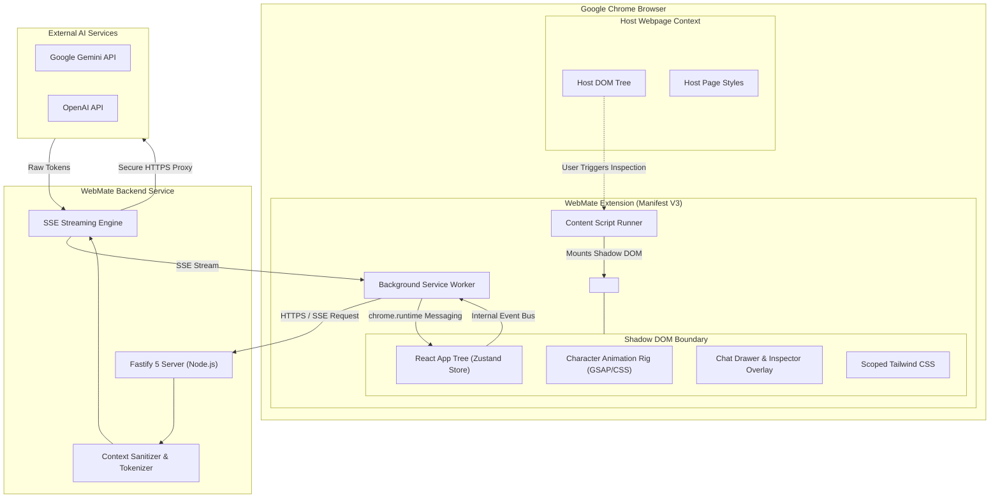
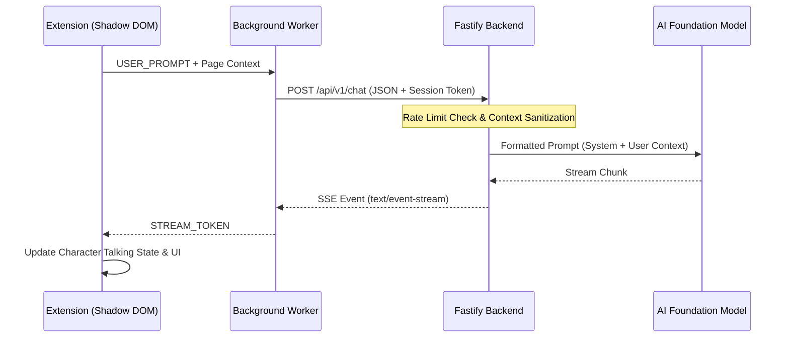

# WebMate — System Architecture

This document describes the architectural design of WebMate, covering the Chrome extension client, backend gateway, Shadow DOM isolation model, inter-process communication (IPC), and security perimeters.

---

## 1. System Architecture Diagram



---

## 2. Chrome Extension Architecture (`@webmate/extension`)

The extension follows the Chrome Manifest V3 execution model, split into three decoupled tiers:

### A. Background Service Worker (`entrypoints/background.ts`)
- **Role**: Event-driven background orchestrator.
- **Responsibilities**:
  - Responds to extension installation, updates, and icon clicks.
  - Acts as a secure HTTP client to communicate with the `@webmate/backend` service.
  - Manages cross-tab state, persistent extension settings in `chrome.storage.local`.
  - Dispatches messages to active content scripts.

### B. Content Script & Shadow DOM Injection
- **Role**: Injected bridge living within the webpage context.
- **Responsibilities**:
  - Injects a custom container element (`#webmate-host`) into the host page `document.body`.
  - Attaches a **Shadow DOM** (`shadowRoot = host.attachShadow({ mode: 'open' })`).
  - Renders the React root into the Shadow DOM.
  - Listens to host page mouse events exclusively when "Inspect Element" mode is activated.

### C. Extension Action Popup (`entrypoints/popup/`)
- **Role**: Quick toolbar interface.
- **Responsibilities**:
  - Displays extension status, global on/off toggle, and link to options.
  - Summarizes current session activity and backend connectivity.

---

## 3. Shadow DOM Isolation Strategy

Injecting custom UI into arbitrary third-party websites presents significant styling and DOM conflict risks:
1. Host CSS rules (e.g. `* { box-sizing: border-box; font-family: ... }` or resets) can corrupt companion elements.
2. Companion CSS rules could inadvertently alter host page layout and typography.
3. Host page JavaScript could traverse and manipulate extension DOM nodes.

```
+-------------------------------------------------------+
| Host Webpage Document Body                            |
|                                                       |
|   <div class="header">...</div>                       |
|   <main class="content">...</div>                     |
|                                                       |
|   <div id="webmate-host">                             |
|     #shadow-root (open)                               |
|       +---------------------------------------------+ |
|       | <style> /* Scoped WebMate CSS */ </style>   | |
|       | <div class="webmate-container">             | |
|       |   <svg id="character-rig">...</svg>         | |
|       |   <div class="chat-drawer">...</div>        | |
|       | </div>                                      | |
|       +---------------------------------------------+ |
|   </div>                                              |
+-------------------------------------------------------+
```

### Isolation Rules:
- All extension markup lives inside `#shadow-root`.
- Tailwind CSS styles are compiled and injected directly inside the shadow root via `<style>` tag insertion or `adoptedStyleSheets`.
- Events generated inside the Shadow DOM (clicks on chat input, character drag events) stop propagation to host DOM listeners where appropriate to prevent triggering host website interactions.

---

## 4. Backend Gateway Architecture (`@webmate/backend`)

The backend is a Node.js microservice built with **Fastify**:



### Key Responsibilities:
- **API Key Secrecy**: External AI credentials never leave the backend environment.
- **Prompt Guardrails & Sanitization**: Strips HTML tags, script nodes, and masked credentials before sending prompts to the LLM.
- **Streaming Response Gateway**: Implements Server-Sent Events (SSE) so responses stream token-by-token directly to the extension.
- **Rate Limiting**: Protects downstream LLM endpoints from abuse via IP and session throttling.

---

## 5. Security & Isolation Boundaries

| Boundary | Enforcement Mechanism |
| :--- | :--- |
| **Host DOM vs Extension UI** | Shadow DOM (`attachShadow({ mode: 'open' })`) + CSS scoping |
| **Extension vs Network** | Strict Manifest V3 Content Security Policy (no remote scripts) |
| **Extension vs AI API Keys** | Proxy through `@webmate/backend`; extension holds zero credentials |
| **User Privacy vs Context** | User-triggered context ingestion only; automatic password stripping |
