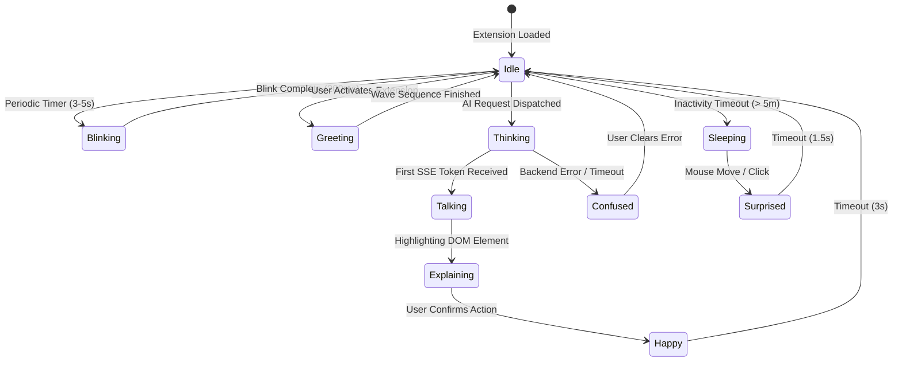

# WebMate — Character Asset Architecture (Phase 1, Step 1)

This document establishes the comprehensive technical architecture for integrating the **WebMate Original Mascot** character as the interactive floating browser companion in WebMate.

---

## 1. Executive Summary & Character Identification

WebMate's floating companion is designed as a completely original cartoon boy mascot embodying charm, playful curiosity, and comedic expressiveness:
- **Distinctive Silhouette & Hairstyle**: Rounded chibi head contour with cute side-swept dark hair featuring subtle specular sheen.
- **Expressive Facial Features**: Thick, expressive cartoon eyebrows capable of dynamic articulation, large anime eyes with dual specular catchlights, cute button nose, and versatile mouth geometries.
- **Original Attire**: Red-orange short-sleeved crew-neck t-shirt with a gold-and-white chest lightning emblem, warm mustard yellow shorts, white athletic socks, and cyan/teal speed-striped sneakers.
- **Personality in Motion**: Curious, cheeky, confident, and humorous reactions that demystify web pages and reduce user intimidation when navigating dense digital content.

To bring this original mascot to life within a web browser without lagging host pages, the architecture employs an articulated, multi-layered vector rig rather than static images or pre-rendered videos.

---

## 2. Character Expressions Specification

WebMate defines 8 canonical facial expressions tailored to browser interaction events:

| Expression | Visual Design Specifications | Companion Mood & Usage |
| :--- | :--- | :--- |
| **Normal** | Natural relaxed eyebrows with gentle arch; round pupils centered; subtle characteristic smirk/smile curving upward. | Default browsing companion state; attentive observer. |
| **Happy** | Eyebrows raised high; eyes curved into crescent smiling slits (`^ ^`) or dilated with star/sparkle reflections; wide open smile with visible pink tongue; blushing rosy cheeks. | Page successfully summarized; form field successfully filled; positive user confirmation. |
| **Thinking** | Left eyebrow arched high, right eyebrow furrowed downward; eyes directed toward top-right corner; mouth pursed or small wavy line; hand touching chin. | Backend AI query in progress; parsing complex DOM structures. |
| **Surprised** | Eyebrows shooting up past head hairline; pupils contracted into small dots surrounded by wide white sclera; mouth open in a vertical oval (`O`); sweat bead pop. | Unhandled error detected; sudden DOM mutation or broken link. |
| **Confused** | Asymmetrical wavy eyebrows; head tilted 15 degrees; mouth shifted sideways with wavy contour; diagonal blue lines or sweat drop on temple. | Search query returned ambiguous results; element not found in DOM. |
| **Explaining** | Focused, confident eyebrows slightly slanted inward; eyes focused directly on the user or host element; open speaking mouth; hand gesturing forward. | Actively presenting element explanations or step-by-step guidance. |
| **Talking** | Dynamic mouth shape cycling (closed, half, open) timed to text streaming; eyes maintaining natural blinking cadence; eyebrows gently pulsing to emphasis. | Real-time text token stream arriving from the backend LLM. |
| **Sleeping** | Drooping curved eye slits (`- -`); relaxed slightly open mouth with expanding/contracting snot bubble; floating animated `Zzz` letters. | Extended user inactivity (> 5 minutes without cursor movement or scroll). |

> [!NOTE]
> **Expression vs. Behavioral States**: While listed above as visual presets, `Talking` (stream-triggered mouth oscillation) and `Sleeping` (slumped posture with snot bubble and `Zzz` FX) are composite **behavioral/display states** combining facial posture with active animation loops and particle overlays, rather than strictly static facial expressions.

---

## 3. Animation States & Technical Requirements

The animation subsystem is divided between **procedural skeletal transitions** (managed via GSAP and CSS transforms) and **frame-based sprite transitions** (managed via SVG path swaps or sprite sheets).



### Detailed Animation Specifications

#### 1. Idle Animation
- **Technical Mechanism**: Continuous CSS `@keyframes` on GPU compositor thread.
- **Layers Affected**: Torso, head, arms, and ground shadow.
- **Motion**: Vertical floating bob (4px displacement, 2.2s sinusoidal loop `ease-in-out`) synchronized with inverted scale of ground shadow (`scaleX(0.95)` at peak height).

#### 2. Eye Blinking
- **Technical Mechanism**: Procedural SVG transform or 2-frame path swap.
- **Layers Affected**: `#layer-eyes`, `#layer-eyelids`.
- **Motion**: Quick squash transform (`scaleY(0.1)` on eye center pivot) lasting 120ms, followed by 80ms rebound to `scaleY(1.0)`. Triggered every 3.5 to 6.0 seconds via pseudo-random interval.

#### 3. Greeting / Waving
- **Technical Mechanism**: GSAP Timeline sequence.
- **Layers Affected**: `#layer-arm-right`, `#layer-hand-right`, `#layer-head`.
- **Motion**: Right arm elevates to 45 degrees, hand performs 3 rapid lateral wave oscillations (±15 degrees rotation around wrist anchor point, 180ms per stroke), head tilts 5 degrees in sync.

#### 4. Thinking
- **Technical Mechanism**: GSAP Timeline + dynamic SVG particle emitter.
- **Layers Affected**: Eyebrows (asymmetrical slant), eyes (glance up-right), right arm (raises hand to chin), `#layer-fx` (subtle floating question mark or dots drifting upward with opacity fade).

#### 5. Explaining
- **Technical Mechanism**: Dynamic vector pointing vector computation.
- **Layers Affected**: `#layer-arm-right`, `#layer-hand-right` (with pointing index finger), `#layer-head` (rotates toward target coordinate).
- **Motion**: Arm rotates around shoulder joint to point directly at the target element's viewport bounding box.

#### 6. Talking
- **Technical Mechanism**: Text-stream-triggered mouth animation.
- **Layers Affected**: `#layer-mouth`.
- **Motion**: Cycles among 3 distinct mouth geometry shapes:
  - `mouth_closed` (rest width: 14px, height: 4px)
  - `mouth_half` (width: 16px, height: 10px)
  - `mouth_open` (width: 18px, height: 16px, tongue visible)
  Triggered dynamically as text tokens arrive from backend Server-Sent Events (SSE).
- **Audio Synchronization Clarification**: The current design uses **text-stream-triggered mouth animation** (pacing mouth openings to incoming token bursts) to provide lively visual speech feedback. This is intentionally distinguished from true phoneme-level lip-sync. True phoneme-level lip-sync would require a separate audio/speech synchronization pipeline (e.g. text-to-speech audio synthesis with phoneme-level forced alignment or viseme timing cues).

#### 7. Happy Reaction
- **Technical Mechanism**: GSAP spring bounce (`bounce.out`) + cheek particle sparkle.
- **Layers Affected**: Entire character rig (jumping 16px vertically), `#layer-blush` (opacity pulse 0.4 -> 0.9), `#layer-fx` (sparkle stars orbiting head).

#### 8. Sleeping
- **Technical Mechanism**: Slow sinusoidal breathing curve + cyclic snot bubble animation.
- **Layers Affected**: Character torso (sagging 6px), head (drooping forward 8 degrees), `#layer-fx` (snot bubble expanding from 2px to 14px over 3 seconds, bursting, then resetting; staggered floating `Zzz` path translations).

---

## 4. Layered Asset Requirements

### Why a Single Flattened PNG Is Insufficient

Using a single flattened raster image (or pre-rendered flat PNGs) fails the project requirements for the following technical reasons:

1. **Combinatorial Explosion of Assets**:
   Combining 8 expressions with 8 body poses, multiple arm orientations, and lip-sync states would require rendering hundreds of unique full-body PNG frames (e.g., $8 \text{ expressions} \times 4 \text{ body states} \times 3 \text{ arm positions} \times 3 \text{ mouth states} = 288\text{ high-res frames}$), inflating extension bundle size past 60MB.
2. **Loss of Articulation & Dynamic Pointing**:
   WebMate must point to arbitrary element bounding boxes across 360-degree angles on arbitrary screen resolutions. A flattened image cannot rotate an arm toward dynamic coordinates $(x, y)$ without redrawing the entire character.
3. **Stream-Triggered Mouth Animation**:
   Text tokens stream from the LLM at variable intervals. Layered vector mouths allow cycling mouth geometry directly in response to incoming token bursts without repainting the entire character canvas. True phoneme lip-sync would require dedicated audio/speech analysis, whereas the current scope focuses on stream-triggered visual pacing.
4. **Retina & High-DPI Crispness**:
   Raster images blur or pixelate when scaled or zoomed. Layered vector SVGs remain crisp at any display density and viewport size with low memory overhead (with a provisional optimization target of < 80KB total asset payload, subject to runtime measurement upon asset integration).

### Architectural Layer Separation

The character rig is organized into strict hierarchical z-index layers with clearly defined rotational pivot points (anchors):

```
Z-Index Layer Hierarchy:
┌────────────────────────────────────────────────────────┐
│ Layer 6: FX Overlays (Zzz, Sweat, Snot Bubble, Sparkle)│
├────────────────────────────────────────────────────────┤
│ Layer 5d: Mouth (Swappable Mouth Shape Geometries)     │
├────────────────────────────────────────────────────────┤
│ Layer 5c: Eyes & Eyelids (Blink & Gaze Direction)      │
├────────────────────────────────────────────────────────┤
│ Layer 5b: Eyebrows (Independent Asymmetric Rotations)  │
├────────────────────────────────────────────────────────┤
│ Layer 5a: Blush & Cheeks (Rosy Pulse)                  │
├────────────────────────────────────────────────────────┤
│ Layer 4: Head Contour & Hair (Pivot: Neck Joint)       │
├────────────────────────────────────────────────────────┤
│ Layer 3: Foreground Arm (Right) (Pivot: Shoulder)      │
├────────────────────────────────────────────────────────┤
│ Layer 2: Torso, Shorts & Legs (Root Anchor)            │
├────────────────────────────────────────────────────────┤
│ Layer 1: Background Arm (Left) (Pivot: Shoulder)       │
├────────────────────────────────────────────────────────┤
│ Layer 0: Ground Drop Shadow (Pivot: Base Center)       │
└────────────────────────────────────────────────────────┘
```

#### Layer Pivot Coordinates (Based on 200 × 250 ViewBox):
- **Ground Shadow**: `(100, 240)` — Anchor for scaling during vertical bobs.
- **Torso Root**: `(100, 170)` — Base anchor for breathing animations.
- **Neck / Head Joint**: `(100, 115)` — Pivot for head tilting and nodding.
- **Left Shoulder**: `(70, 135)` — Pivot for waving or resting arm.
- **Right Shoulder**: `(130, 135)` — Pivot for dynamic pointing arm.
- **Left Eyebrow**: `(85, 75)` — Center pivot for arching / furrowing.
- **Right Eyebrow**: `(125, 75)` — Center pivot for arching / furrowing.
- **Mouth Anchor**: `(105, 105)` — Replacement locus for swappable mouth shapes.

---

## 5. Asset Directory Architecture

The proposed directory layout within `apps/extension` isolates development source files, swappable expression vectors, runtime sprite sheets, and automated metadata:

```
apps/extension/
├── assets/
│   └── character/
│       ├── manifests/
│       │   └── character.manifest.json      # Rig definition: layers, anchors, dimensions, bounds
│       ├── source/                          # Vector source definitions (Git-tracked schema / placeholders)
│       │   ├── template-rig.svg             # Full baseline vector rig blueprint
│       │   └── layers/
│       │       ├── 00-shadow.svg
│       │       ├── 01-arm-left.svg
│       │       ├── 02-body-torso.svg
│       │       ├── 03-arm-right.svg
│       │       ├── 04-head-base.svg
│       │       └── 05-hair.svg
│       ├── expressions/                     # Modular facial feature SVG fragments
│       │   ├── normal/
│       │   │   ├── eyebrows.svg
│       │   │   ├── eyes.svg
│       │   │   └── mouth.svg
│       │   ├── happy/
│       │   │   ├── eyebrows.svg
│       │   │   ├── eyes.svg
│       │   │   ├── mouth.svg
│       │   │   └── blush.svg
│       │   ├── thinking/
│       │   │   ├── eyebrows.svg
│       │   │   ├── eyes.svg
│       │   │   └── mouth.svg
│       │   ├── surprised/
│       │   │   ├── eyebrows.svg
│       │   │   ├── eyes.svg
│       │   │   └── mouth.svg
│       │   ├── confused/
│       │   │   ├── eyebrows.svg
│       │   │   ├── eyes.svg
│       │   │   └── mouth.svg
│       │   ├── explaining/
│       │   │   ├── eyebrows.svg
│       │   │   ├── eyes.svg
│       │   │   └── mouth.svg
│       │   ├── talking/
│       │   │   ├── mouth-closed.svg
│       │   │   ├── mouth-half.svg
│       │   │   └── mouth-open.svg
│       │   └── sleeping/
│       │       ├── eyes-closed.svg
│       │       └── mouth-sleeping.svg
│       ├── animations/                      # Motion curves, timing constants, and frame metadata
│       │   ├── idle.motion.json
│       │   ├── blink.motion.json
│       │   ├── wave.motion.json
│       │   ├── think.motion.json
│       │   ├── explain.motion.json
│       │   ├── talk.motion.json
│       │   ├── happy.motion.json
│       │   └── sleep.motion.json
│       ├── sprites/                         # Optional runtime sprite sheets for complex FX
│       │   ├── fx-particles.png             # Particle atlas (sparkles, Zzz, sweat drop)
│       │   └── fx-particles.json            # Atlas frame definitions
│       ├── runtime/                         # Assembled, tree-shakable React vector component
│       │   └── CharacterRig.tsx             # Programmatic SVG rig component with dynamic props
│       └── ingestion/                       # Safe local custom asset ingestion tools
│           ├── README.md                    # Guidelines for injecting custom or licensed character SVGs
│           └── validate-asset.js            # Node verification script checking layers against manifest
```

### Character Manifest Schema (`character.manifest.json` Preview)

```json
{
  "name": "webmate-mascot-standard",
  "version": "1.0.0",
  "viewBox": "0 0 200 250",
  "anchors": {
    "shadow": { "x": 100, "y": 240 },
    "torso": { "x": 100, "y": 170 },
    "head": { "x": 100, "y": 115 },
    "leftShoulder": { "x": 70, "y": 135 },
    "rightShoulder": { "x": 130, "y": 135 },
    "leftEyebrow": { "x": 85, "y": 75 },
    "rightEyebrow": { "x": 125, "y": 75 },
    "mouth": { "x": 105, "y": 105 }
  },
  "layers": [
    { "id": "layer-shadow", "zIndex": 0, "anchor": "shadow", "description": "Ground drop shadow plane with dynamic scaleX transform." },
    { "id": "layer-arm-left", "zIndex": 10, "anchor": "leftShoulder", "description": "Background support arm." },
    { "id": "layer-body", "zIndex": 20, "anchor": "torso", "description": "Torso, red shirt, yellow shorts, legs and shoes." },
    { "id": "layer-arm-right", "zIndex": 30, "anchor": "rightShoulder", "description": "Foreground articulated arm for waving and 360-degree pointing." },
    { "id": "layer-head", "zIndex": 40, "anchor": "head", "description": "Base head contour and hair with neck rotational pivot." },
    { "id": "layer-blush", "zIndex": 45, "anchor": "head", "description": "Cheek blush overlays with dynamic opacity pulse." },
    { "id": "layer-eyebrows", "zIndex": 50, "anchor": "head", "description": "Thick black eyebrows with independent rotational pivots." },
    { "id": "layer-eyes", "zIndex": 52, "anchor": "head", "description": "Sclera and pupil layers with procedural squash blinking." },
    { "id": "layer-mouth", "zIndex": 55, "anchor": "mouth", "dynamic": true, "description": "Swappable mouth shape geometries triggered during text streaming." },
    { "id": "layer-fx", "zIndex": 60, "anchor": "head", "dynamic": true, "description": "Emotional FX overlays (Zzz, snot bubble, sweat drop, sparkles)." }
  ]
}
```

---

## 6. Intellectual Property, Artwork Ownership & Licensing Architecture

WebMate enforces a strict separation between open-source code infrastructure and original mascot artwork:

1. **Software Engine Licensing (Apache-2.0)**:
   - The core WebMate extension engine, including the 12-layer SVG character rig architecture (`CharacterRig.tsx`), layer renderers (`CharacterLayers.tsx`), docking physics, Chrome storage persistence, Shadow DOM mounting, and GSAP procedural animation pipelines (`apps/extension/src/character/animation/`), is licensed under the permissive **Apache License, Version 2.0**.
2. **WebMate Original Mascot Artwork**:
   - The companion mascot is a **100% original creative work** created specifically for WebMate. All vector geometries, palettes (`apps/extension/src/character/artwork/palette.ts`), layer components (`ShadowArtwork` through `EffectsArtwork`), and character designs represent original proprietary WebMate artwork.
3. **Third-Party Intellectual Property Disclaimer**:
   - WebMate is an independent project. The mascot is **NOT** Crayon Shin-chan (Shinnosuke Nohara) and does not utilize, reproduce, or distribute copyrighted artwork, character likenesses, broadcast frames, or trademarks owned by Yoshito Usui, Futabasha Publishers Ltd., Shin-ei Animation Co., Ltd., or TV Asahi Corporation.
4. **Decoupled Asset Architecture**:
   - The character rig operates against an abstract, typed layer contract (`CharacterManifest` and `CharacterAssetRegistry`). Third-party copyrighted assets must **never** be checked into this Git repository. Users or developers wishing to inject custom local artwork may do so via the documented ingestion interface.

---

## 7. Next Steps in Phase 1

With the asset architecture finalized in **Phase 1, Step 1**, the roadmap proceeds to:
- **Phase 1, Step 2**: Content script injection and Shadow DOM isolation mounting (`<webmate-root>`).
- **Phase 1, Step 3**: Draggable floating container physics and docking state management.
